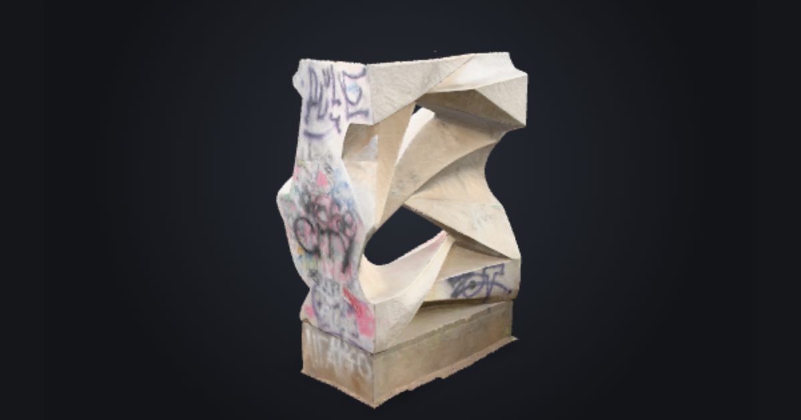
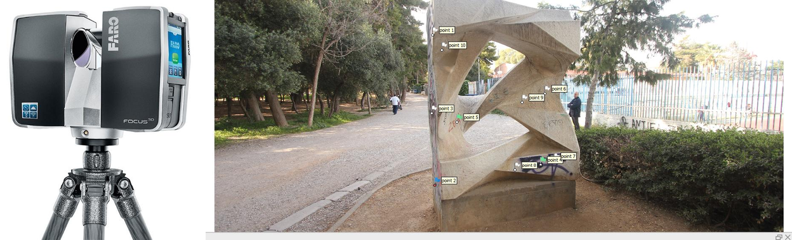
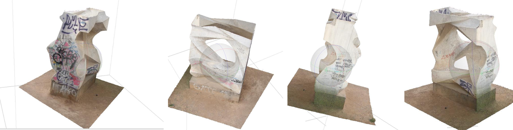
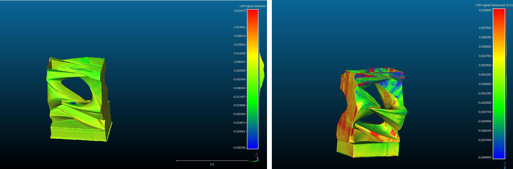
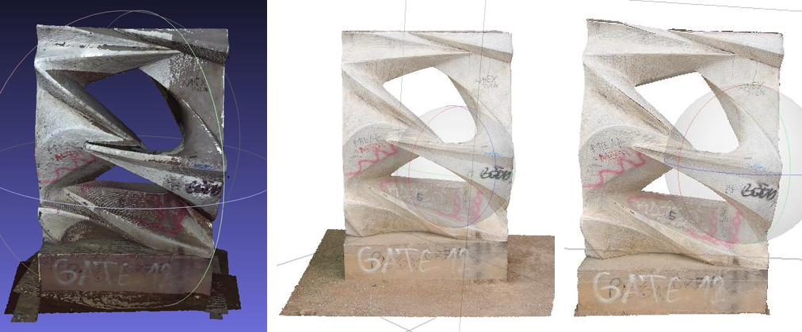
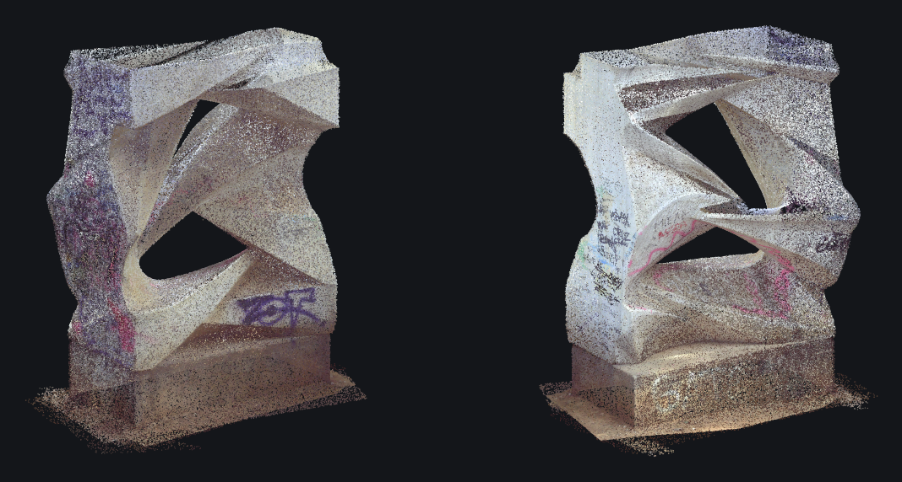

# 3D Reconstruction & Multi-Sensor Fusion: TLS vs. Close-Range Photogrammetry

A comparative post-processing and sensor fusion study evaluating **Terrestrial Laser Scanning (TLS)** against **Close-Range Digital Photogrammetry (SfM/MVS)** for high-precision 3D digital preservation and geometric analysis.

📄 **[Read the Full Technical Report (PDF - Greek)](./3D_Reconstruction_TLS_Photogrammetry_Report.pdf)**

🌐 **Interactive 3D viewer:** [https://agathiba.github.io/3d-reconstruction-tls-photogrammetry/](https://agathiba.github.io/3d-reconstruction-tls-photogrammetry/)

<p align="center">
  <a href="https://agathiba.github.io/3d-reconstruction-tls-photogrammetry/"></a>
  <br><em>Click to rotate and zoom the models in your browser</em>
</p>

<p align="center">
  
  <br><em>FARO Focus laser scanner (left) and the statue that was reconstructed (right)</em>
</p>

---

## 📌 Project Overview
The objective of this project is the reconstruction, optimization, and quantitative comparison of 3D models derived from survey datasets of an outdoor monument:
1. **Terrestrial Laser Scanning (FARO Focus):** High-precision geometry from 8 point clouds (>6.6M vertices).
2. **Close-Range Photogrammetry (Canon EOS 550D):** Structure-from-Motion (SfM) processing of 81 high-resolution images.
3. **Hybrid Textured Model:** Combining LiDAR geometric fidelity with high-resolution photogrammetric texture mapping.

---

## 🛠️ Methodological Workflow

### 1. Point Cloud Processing & Meshing (MeshLab)
* **Noise Removal & Preprocessing:** Segmented and filtered unwanted surroundings across 8 raw `.txt` scans (XYZRGB format).
* **Normal Vector Estimation:** Computed surface normals via neighboring point analysis (k-neighbors tuned from 10 to 50) and viewpoint orientation adjustments.
* **Registration & Alignment:** Coarse alignment via manual homologous points, followed by fine registration using the **Iterative Closest Point (ICP)** algorithm (achieved target errors < 4 mm).
* **Surface Reconstruction:** Applied **Poisson Surface Reconstruction** (depth 10) to generate clean, watertight triangular meshes, followed by non-manifold edge and boundary cleaning.

### 2. Digital Photogrammetry Pipeline (Agisoft Metashape Pro)
* **Image Alignment (SfM):** Camera calibration and feature matching on 81 multi-angle images, solving exterior orientation parameters.
* **Dense Cloud Generation:** Computed high-density depth maps with optimized bounding box limits to filter vegetation artifacts.
* **Textured Mesh:** Built high-detail geometry and generated texture atlases using blending weights for photo consistency.

<p align="center">
  
  <br><em>Textured photogrammetric model (Agisoft Metashape), multiple views</em>
</p>

### 3. Sensor Fusion & Hybrid Reconstruction
* Imported the TLS Poisson mesh into Agisoft Metashape.
* Positioned 10 distributed Ground Control Points (GCPs) across the geometry and identified them across multiple photos.
* Executed **Bundle Adjustment** (optimized camera poses, achieving total reprojection error < 0.1 px).
* Projected photogrammetric texture onto the LiDAR-derived geometric surface.

### 4. Quantitative Geometric Inspection (CloudCompare)
* Evaluated geometric discrepancy between the TLS and Photogrammetric meshes using the **Cloud-to-Mesh (C2M)** distance tool.
* Successfully demonstrated model convergence with surface deviations predominantly constrained within **±1–2 cm**.

<p align="center">
  
  <br><em>Cloud-to-mesh deviation maps in CloudCompare</em>
</p>

<p align="center">
  
  <br><em>Texture quality of the three models: laser scanner (left), photogrammetry (middle), hybrid (right)</em>
</p>

---

## 💻 Software & Tools
* **Software:** MeshLab, Agisoft Metashape Pro, CloudCompare
* **Data Sources:** FARO Focus TLS scans, Canon EOS 550D DSLR images

---

## 🧊 3D Models

<p align="center">
  
  <br><em>Terrestrial laser scanning point cloud (FARO Focus) with RGB colour – 500k-point subset, two views</em>
</p>

| File | Content | Size |
| :--- | :--- | :--- |
| [`models/statue_photogrammetry.stl`](./models/statue_photogrammetry.stl) | Photogrammetric mesh (Agisoft Metashape), decimated to 150k triangles – opens in GitHub's 3D viewer | 7.5 MB |
| [`models/statue_hybrid.stl`](./models/statue_hybrid.stl) | Hybrid TLS + photogrammetry mesh, decimated from 5.75M to 200k triangles | 10 MB |
| [`models/statue_tls_pointcloud_500k.ply`](./models/statue_tls_pointcloud_500k.ply) | FARO Focus point cloud with RGB, randomly subsampled from 6.6M to 500k points – open in CloudCompare or MeshLab | 7.5 MB |
| `docs/models/*.glb` | Coloured versions of both meshes used by the web viewer | 3–4 MB |

The meshes were decimated with quadric edge collapse (Open3D) so they can be viewed online; the full-resolution models are available on request. The STL/GLB meshes are centred on the base of the statue, while the point cloud keeps the original project coordinates.

## 📁 Repository Structure

```
├── docs/                      # Web viewer, published with GitHub Pages
│   ├── index.html
│   └── models/                # statue_hybrid.glb, statue_photogrammetry.glb
├── models/                    # STL meshes and TLS point cloud (PLY)
├── images/                    # Figures used in this README
└── 3D_Reconstruction_TLS_Photogrammetry_Report.pdf
```
